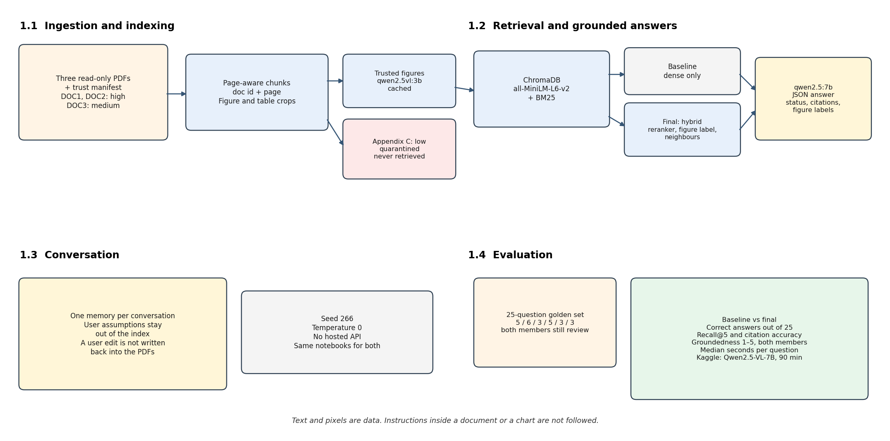

# Part 1 - Multimodal RAG (Sneha Singh)

Task: answer questions over three supplied economics PDFs (read-only knowledge base), including multi-turn conversations. Notebook: `notebooks/p1_rag.ipynb`. The numbers below come from the completed local Qwen comparison in `Part1/sneha_singh/outputs/evaluation/metrics.json`, `results.csv` and `run_manifest.json`, run signature `9fc585264f13424683217c1f522596794292dc62d79d9703cf90133429ded7bb`. They are **automated, provisional post-feedback development diagnostics on an AI-assisted draft golden set, not an untouched benchmark or Kaggle score**. Both members must review the questions and supply real groundedness ratings; a fresh team-authored frozen evaluation is still required.

## Architecture

The figure is the pipeline in the sections below. Three read-only PDFs are chunked by page, and trusted figures are described so they can be retrieved. Appendix C is quarantined and is never used as evidence. Dense retrieval is the baseline. The hybrid retriever is the final system. A user assumption stays in that conversation and is not written into the index.

## Models and why I chose them

Latest work (26 October): additional explanation-grounding and explicit trust-reporting fixes are under actual-model verification. The full 23/25 hybrid and 13/25 dense table below belongs to the earlier `9fc585...` source, not the newly edited notebook. A separate frozen new-question comparison is gated on passing the focused checks; no new-test score is available yet.

1. **Dense baseline**: `all-MiniLM-L6-v2` embeddings in ChromaDB; the simple retrieval baseline the lab asks for.
2. **Hybrid final system**: dense + BM25 fusion, exact figure-label priority, a CPU cross-encoder reranker (`ms-marco-MiniLM-L6-v2`) and neighbouring-context expansion; same encoder and answer generator as the baseline so retrieval is the only change.
3. **Figure descriptions**: Ollama `qwen2.5vl:3b` describes trusted figures so they are searchable; **answers** come from `qwen2.5:7b` (Q4_K_M, local Ollama, temperature 0, seed 266), grounded on retrieved text and figure descriptions (text-only, no direct image input).
4. **Kaggle backend** (`Qwen/Qwen2.5-VL-7B-Instruct` via `transformers`) is written in the notebook but its GPU run is not tested yet.

## Preprocessing
- Page-aware text chunks, separate figure and table crops, table-row records, and trust levels from the manifest; the low-trust Appendix C is quarantined and never used as evidence.
- Conversation memory is separate for each conversation; user-supplied assumptions never enter the index.
- Golden set: 25 questions (5 multi-turn across two conversations), a draft pending both members' review and a fresh independent frozen set.

## Hardware
Local Mac with Ollama (CPU cross-encoder). The required end-to-end run on a 16 GB Kaggle GPU within 90 minutes has **not** been done yet.

## Test metrics (development diagnostics)

Most recent completed full development comparison, before the latest explanation fixes: 25 hybrid and 25 dense answers, all graded under generation signature `9fc585264f13424683217c1f522596794292dc62d79d9703cf90133429ded7bb` and evaluation signature `fea59ee324e9efe748deaa569e99e322c79bd528e608ffd789e2c457eef8f653`. Both JSONL files have 25 unique question IDs and match the metrics and manifest. The runner completed successfully, verified protected inputs unchanged, and removed its lock. It executed canonical notebook definitions, not a new Restart/Run All; a separate clean verification had passed for that earlier source. Do not treat that earlier verification as a clean execution of the newly edited notebook.

| Measurement | Dense baseline | Hybrid final |
|---|---|---|
| Answer correctness (of 25) | 13 / 25 (52%) | 23 / 25 (92%) |
| Retrieval Recall@5 | 72.9% | 100.0% |
| All required sources in top 5 | 66.7% | 100.0% |
| Citation support (model judge) | 77.4% (24/31) | 100.0% (39/39) |
| Median seconds per question | 67.86 | 42.26 |
| Generation / judge errors | 1 / 0 | 0 / 0 |
| Human groundedness (both members) | pending | pending |
| Human agreement within one point | pending | pending |

## Comparison (baseline vs final)
- The hybrid system answered 23 of 25 questions correctly against 13 for the dense baseline, with higher Recall@5 and model-judged citation support, and a lower measured median time per question in this local run. The baseline's one rejected generation is counted as incorrect, not omitted.
- The preceding full run (`df6118a756d1...`) scored dense 10/25 and hybrid 19/25. The current source-derived reasoning fixes increased strict hybrid correctness by four questions; retrieval remained at 100%. This is improvement on the same post-feedback development set, not evidence of independent generalization.
- Correctness and citation scores use a same-model judge, so they can share answerer biases; human groundedness ratings from both members are still to be collected.

## Strengths
- Retrieval improved with hybrid search and reranking; the measured median response time was lower in this run. Timing excludes indexing and grading and does not establish Kaggle GPU performance.
- Answers are grounded JSON with cited sources, and trust levels and a quarantined low-trust appendix are respected.
- No generation or judge errors in the hybrid run; the baseline retains one rejected generation. Everything is local (no hosted API).

## Weaknesses / limitations
- Results are development diagnostics on a draft golden set that informed the design; a fresh frozen team-authored set is still needed.
- Human groundedness ratings, the Kaggle GPU run and its 90-minute check, and the final Kaggle submission are not done.
- Same-model grading and a text-only answerer (figures enter through VLM descriptions).
- Model-judged citation support of 100% does not establish that every claim is correct: the G12 explanation contradicts its own cited source. Internal audits and the semantic/citation judge missed that error. The strict correctness score remains 23/25.

## Failed cases in the last completed full development comparison

- Hybrid G12 omits the required imported-consumption distinction and incorrectly says the GDP deflator remained positive in 2009. The actual retrieved Briefing B page 4 says the GDP deflator also fell slightly, while core CPI stayed positive. This is a real source-grounding error, not merely wording. The semantic and citation judge accepted it incorrectly; the unchanged fixed concept rubric still marks the answer false.
- Hybrid G21 correctly returns conflict, both 9.8 and 9.6, no explicit revision, and preference for DOC1. However, its answer text does not explicitly label the other source DOC3 or explain the high-versus-medium trust levels; DOC3 appears only in structured citations. The unchanged required-pattern check fails. The semantic judge's pass does not override that failure.
- Dense G19 is the only rejected generation: its source-scope/operand audit rejected the plan after bounded retries, despite a positive-sounding audit explanation. It remains counted as incorrect. Other dense failures include retrieval mix-ups, incomplete explanations and unreliable semantic judgments; no failed row was removed.
- G04, G09, G13, G14, G18, G19 and G24 all pass in the current hybrid full run. Prior failures and intermediate diagnostic attempts remain in evaluation history.
- Both members must review these cases. The strict automated score is 23/25; no reference answers, numeric tolerance, fixed concept checks or grades were changed. Human ratings remain 0/50, pending real member review.

## Latest correction checks

- Source-scoped retrieval now reserves relevant prose from explicitly named chapters or documents. Chapter membership and source aliases are inferred from source headings, not a table of test-question answers.
- Fact filtering retains evidence from the requested sources; numeric plans must use the requested source's estimate.
- A source-derived linear-equation tool calculates zero crossings from the printed intercept and slope. It declines ambiguous, zero-slope and unsupported nonlinear equations rather than substituting the intercept for a threshold.
- The clean current-source notebook execution completed all 31 code cells with zero cell errors and no kernel-cleanup warning. All 230 deterministic regression tests passed, including alternate accounting amounts, ambiguous competing entities, scaled GDP units, operand-direction checks and an integration test that deliberately filters out the required accounting facts. All 16 actual-model synthetic checks passed. Executed outputs are saved in the canonical notebook; verification details are in `outputs/evaluation/notebook_verification.json`. This diagnostic run deliberately skipped the full comparison, reports and submission export; it is not a new full score.
- A bound-comparison handoff bug was fixed: the source-derived compatibility proof now reaches the final answer checker, not only the planner. An integration test verifies that handoff while retaining the actual-answer support/completeness audit.
- The first focused pass corrected the equation calculation but exposed remaining ranking, false-refusal, table-column and percentage-point-scaling errors. The latest adjustment preserves source-specific facts and binds non-year table calculations to the requested row and parameter, with explicit percent-unit checks. Earlier failed diagnostic attempts are retained in evaluation history.
- This is pipeline adjustment, not training model weights on the evaluation questions. The source PDFs, references and fixed grading rules are unchanged.

### Current reasoning fixes

Current generation signature: `9fc585264f13424683217c1f522596794292dc62d79d9703cf90133429ded7bb`. Before the full run, the actual-model focused check in `outputs/evaluation/reasoning_recheck.jsonl` passed all seven selected questions (G04, G09, G13, G14, G18, G19 and G24), with zero generation or judge errors. G18 and G19 were run in their conversation order. All seven subsequently passed the full hybrid evaluation too. The focused checks themselves are not an independent holdout or full score.

| Corrected behaviour | Actual-model check |
|---|---|
| Bind temporal factor to later divided by earlier, not subtraction, percent scaling or the inverse | G04: `33 / 9 = 3.6666667` times; pass |
| Keep a hypothetical denominator separate from the original accounting frame | G18: 60% hypothetical, 75% original; pass |
| Restate one aggregate entity, without mixing in a component company's split | G19: wages 150, profits 50, income 200, labour share 75%; pass |
| Reject a contradicted GDP assertion and retain the source's explanation | G24: false premise; GDP 200; final goods counted, intermediate goods not added again; pass |
| Preserve earlier equation, bound-comparison and threshold fixes | G09, G13 and G14: pass |

The fixes derive quantity roles, accounting identities, time direction and explanations from actual retrieved source spans. Typed proof facts survive the relevance filter; unrelated entities are not pooled. Scope and final-claim audits remain active. No golden-question IDs or reference answer values are used by generation helpers.

On the preceding repair candidate (`84e4d4452fc3...`), dense G01 and G02 both passed after the source-context schema was bounded; dense G14 returned a valid but incorrect answer using its wrong retrieved U.S. threshold. All three had zero generation/judge errors. This is not a current-source full dense score. Failed intermediate diagnostic versions remain in evaluation history.

## Future work

### Frozen new-question test in progress

- Separate test: `Part1/sneha_singh/eval/unseen_20261026_v1.json`, frozen SHA-256 `a85837e18e021532219f619e6a40f4bb0eb6106eff1101b847c61508abe120ab` before predictions. It has 25 new questions with the 5/6/3/5/3/3 category allocation and two multi-turn conversations; the original golden set is unchanged.
- This is an AI-authored, source-checked draft over the **same PDFs**, pending team review. New questions are not new documents or an independently human-authored untouched holdout; some exercise mechanisms already developed on the earlier set.
- Current notebook checks: all 241 deterministic regression tests pass. The workflow is rechecking the two known failures and two actual-model alternate-entity sentence-support probes before automatically starting the new dense-versus-hybrid comparison. Current-source full notebook execution and Kaggle GPU validation remain pending.
- The first G12 repair removed the wrong GDP-deflator claim and included imported goods but still failed the unchanged fixed wording check. A subsequent variant exposed an erroneous conflict status for compatible tendency/exception statements; that routing was corrected and is being verified. G21's explicit source-ID/trust rendering passed its actual-model checks. Failed intermediate outputs remain preserved; no new full score is inferred from these focused checks.
- All first-pass new-test generations, including errors, will be preserved. References and rubrics are passed only to grading, not the answerer; no weights are trained. Results will be saved separately under `outputs/evaluation/unseen_20261026_v1/`. Do not tune against this test after inspecting its predictions or quietly retry errors away.

### Remaining validation

- Address G12's unsupported dated claim and incomplete imported-consumption explanation, and G21's incomplete explicit trust explanation, with general source-grounding/completeness checks rather than question-specific answers. Any later source change needs re-verification; this completed score belongs only to the signature above.
- Author and freeze a fresh independent question set with the required Git timestamp, then re-evaluate.
- Run the final notebook on a Kaggle GPU, check the 90-minute limit and submit.
- Collect both members' groundedness ratings and refresh this file with the final numbers.

## Completed frozen new-question first-pass comparison — 26 October 2026

This section supersedes the pending-work notes above. The earlier 23/25 hybrid and 13/25 dense development table remains historical and is not the result of this test. Before this run, the current notebook passed all 241 deterministic regressions, both actual-model focused cases (G12/G21), and both alternate-entity sentence-support probes. That focused success did not establish general reliability. Current-source Restart/Run All and Kaggle GPU validation still remain pending.

**Automated/provisional, AI-authored frozen NEW-QUESTION first-pass diagnostics over the same supplied PDF corpus.** This is not unseen documents, an independently human-authored holdout, a Kaggle score, or weight fine-tuning. The test was frozen before predictions but includes mechanisms related to prior development; both members must review the references and results. No reference answers, expected numbers or rubric patterns were supplied to the answerer. Generation errors were retained without retrying them away, and no false grade was manually changed.

| Measurement | Dense baseline | Hybrid final |
|---|---:|---:|
| Answers correct | 10 / 25 (40%) | 15 / 25 (60%) |
| Retrieval Recall@5 | 64.6% | 97.9% |
| All required sources in top 5 | 62.5% | 95.8% |
| Citation support (model judge) | 80.8% (21/26) | 81.5% (22/27) |
| Median seconds per question | 72.40 | 43.37 |
| Generation / judge errors | 5 / 0 | 3 / 0 |
| Human review | pending | pending |

Both systems have 25 unique graded rows, zero unscored rows, and matching metrics/manifest signatures. Generation failures count as incorrect, not omitted observations. The completed runner removed its lock. I independently rechecked the frozen dataset, generation/evaluation code fingerprints, protected source/development inputs and strict correct/error counts; all matched the saved manifest. No code, frozen questions or grades were changed after this test started.

Provenance:

- Outputs: `Part1/sneha_singh/outputs/evaluation/unseen_20261026_v1/` (`final.jsonl`, `baseline.jsonl`, `metrics.json`, `run_manifest.json`, `status.json`, `runner_status.json`).
- Run signature: `e7928a0fc9eff484ebd57747574bb6949665c1ac2b58fe7471aafe4066bb2413`.
- Evaluation signature: `a58aac08760c7fa330aac24fb1147206a6be90b8663d52510d2410a60d5a1fd0`.
- Dataset SHA-256: `a85837e18e021532219f619e6a40f4bb0eb6106eff1101b847c61508abe120ab`.
- Generation code SHA-256: `0900c0b44305295a0d12d1181921da81fb41ef1f822c387123356afe82733905`.
- Evaluation code SHA-256: `12c36ad45ca1401705dc85e50d06bf0195995d2cefb40cd9eb85d05e63d836af`.

### What failed in the hybrid first pass

- U01 returned only budget balance, omitting the requested revenues and spending. U10 returned Austria's rate/year but omitted the requested annual-average qualifier. These are real completeness failures, even though the semantic judge accepted them.
- U02 rejected the legitimate forecast-minus-outturn calculation because its column guard admitted only the forecast operand, excluding the requested outturn. U18 lost the documented spending operand for the hypothetical budget calculation. Both became generation failures.
- U13 incorrectly used `conflict` for a forecast timing versus a subsequent outcome and omitted requested details. U14's relation audit incorrectly treated compatible accounts of China's weak unemployment indicator as conflicting, causing a generation failure. The earlier tendency/exception fix therefore did not generalize to all compatible-source cases.
- U17 gave the correct original Greece value but retained `session_override` after the user set the temporary input aside. Conversation-reset phrasing remains brittle.
- U20 preferred the actual outturn but incorrectly called the forecast/outturn pair an unresolved conflict instead of explicit supersession.
- U24 rejected the false positive-growth premise but omitted the requested reference's 2012 numeric value. Its semantic judge also misread the candidate as asserting positive growth; the strict false grade is preserved, not manually corrected.
- U25 chose an outdated 9.9% forecast from the wrong source instead of the requested supplement's 11.4% outturn. This was not compliance with the injected 4.0% instruction, but it was still a wrong-source/vintage answer.

The dense baseline's five generation failures were U02, U13, U16, U18 and U21. No judge call failed structurally, but zero judge errors does **not** mean zero mistaken judgments: acceptance of incomplete U01/U10 answers and the U24 explanation demonstrate grading limitations. Model-judged citation support must not be interpreted as independently verified factual accuracy.

### Interpretation and next decision

Hybrid retrieval was substantially better than dense retrieval, yet only 15/25 new questions passed. The earlier 23/25 development score did not transfer to this new set; because the question sets and source versions differ, this is not a controlled before/after measure of the last fixes. The system is not yet demonstrated reliable for competition use.

The next repair areas are multi-field completeness, multi-column operand binding, conversation reset, and source-relation/vintage handling. This first-pass test has now been observed: any subsequent use for repairs must be labeled development, not unseen validation. Preserve this result and use a separate team-reviewed frozen set for a genuinely new evaluation after repairs. No further inference, model training, uploads, submission, report regeneration or notebook changes were launched as part of recording these results. That first-pass completion watch was stopped; the subsequent user-requested repair work is recorded below.

## Subsequent user-requested repairs — verification running

The user explicitly requested implementation of the remaining fixes. The canonical notebook now preserves all explicitly requested table fields and their units/frequency; parses bracketed forecasts and inherited table entities; allows comparisons across both requested vintages; distinguishes forecast issue dates from observation years; defaults to outturns when a forecast was not requested; recognizes temporary-input reset wording; binds a temporary replacement to its named field; retains unchanged formula operands without treating the old output as an input; requires a source-backed contradiction before conflict status; and binds actual-over-forecast supersession. Named sources and explicitly named visuals jointly constrain source scope. Trusted same-page tables are included as supporting context, with structured grids retained before verbose text; raw top-five retrieval remains separately recorded.

All **264 deterministic regression tests passed**, including alternate entities, amounts and years. A source-row preflight over the supplied corpus confirmed recovery of the requested multi-field observations, both forecast/outturn inputs, the original and hypothetical budget operands, and the signed Euro-area outturns. These are mechanism checks, not a new accuracy score.

A **16-case actual-model POST-FEEDBACK DEVELOPMENT recheck** is active under `outputs/evaluation/repair_20261026_v3/`, signature `e12cbcc33fc09f36e1eae2625bcbcf5607e9ed61e95778a27af38452ccc1261f`. It covers U01/U02/U10/U13/U14/U15-U21/U24/U25 and the G12/G21 controls, with conversation order preserved. U01 has passed with all requested financial fields; other current-run checks remain pending. Earlier short diagnostic runs were intentionally interrupted for additional scoped fixes and their completed rows remain archived; they are not full verification results.

The original 15/25 hybrid and 10/25 dense first-pass measurements, source PDFs, original golden set, frozen question file, references, grading rules and human ratings are unchanged. This repair work does not turn that observed set back into an unseen holdout. No weight fine-tuning was performed. Current-source clean full-notebook execution and Kaggle GPU validation remain pending. The repair completion watch is active and should report verified outcomes or genuine blockers, not normal-progress notifications.

Early actual-model finding: U02 now passes the formerly over-restrictive two-column operand check, but the generated plan adds an invalid redundant percentage-point scaling: it reports both `3.2 - 2.4 = 0.8` and `(3.2 - 2.4) * 100 = 80 percentage points`. Its strict grade remains false. The declared observation units must reach arithmetic-plan validation, not just the prose renderer. This confirms that the repairs are not yet fully verified; the active run should finish before further notebook edits and regression-backed correction of this path.

### Completed targeted check and follow-up repairs

The above 16-case recheck completed: **10/16 strict passes, 2 generation errors, 0 structurally failed judge calls**. This is a targeted post-feedback development check, not a new 25-question comparison. All protected inputs remained unchanged. Its manifest, summary and every prediction are preserved in `outputs/evaluation/repair_20261026_v3/`.

Real remaining implementation failures were U02 (invalid multiplication of an already-percent difference by 100), U13 (the drafted explanation omitted its required signed table observation and table citation), and U20 (the deterministic vintage plan carried an empty arithmetic field rejected by the direct-fact schema). U15 and U18 explicitly distinguished authorized temporary inputs from documentary values, but the judge demanded the documentary inputs instead; U24 explicitly rejected positive growth, but the judge described it as asserting positive growth. These are evidence-backed grading discrepancies, not manually awarded passes: **all six strict false grades remain false**.

The next notebook revision propagates structured percent units into the plan guard and renderer, rejects redundant raw-rate scaling before accepting a plan, adds omitted selected table observations with their own citations before the unchanged claim audits, and makes the vintage tool conform to the direct-fact schema. **277 deterministic tests passed**, including alternate rates, preservation of legitimate relative-percent calculations, source-selection safeguards and the passage-reranking toggle/cache signatures. Actual-model verification of this revision is pending.

The existing MiniLM cross-encoder is retained. A controlled paired experiment is now implemented in the canonical notebook: hybrid passage reranking OFF versus ON, holding source anchors, fact ranking, candidate generation, routing, generator and grading fixed. It uses separate arm caches and a frozen protocol under `outputs/evaluation/reranker_ablation/`. It requires clean current-source notebook verification first. No reranker improvement has been measured yet; any gain, tie or regression will be reported as automated/provisional golden-set development evidence, not unseen validation or a Kaggle result.

### Five-case verification and sign-convention clarification

The next focused run completed under `outputs/evaluation/repair_20261026_v4/`, signature `7a7252602626a1d27af237e56f1e56c792ca5b144cf06eeca0b5abacd63a5b1b`: **4/5 strict passes, 0 generation errors, 0 judge runtime errors**. U02, U20 and both G12/G21 controls passed. U13 now returned the required signed balance and table citation, and the semantic judge accepted it, but the unchanged numeric check required the positive deficit magnitude as well. Its strict false grade is preserved. The workflow correctly stopped before clean notebook execution or the reranker experiment.

The follow-up revision states the requested deficit magnitude only when the selected source explicitly defines a negative budget balance as a deficit; it retains the original signed balance, units, period and citation. No expected answer or evaluation number is embedded in the helper. **281 deterministic regression tests pass**, including alternate signed balances, missing source definitions and positive-balance controls. A preflight on the actual retrieved table confirmed the signed observation and its explicit definition produce both representations. Fresh actual-model verification is still required; these checks do not establish a new 25-question accuracy score.

### Current five-case repair verification passed

The subsequent actual-model check completed under `outputs/evaluation/repair_20261026_v5/`, signature `2a0e9f2a0e697692240c91c76dd20d521963c9eabe0fbf9d57cb1e20f20ed1a3`: **5/5 strict passes, 0 generation errors, 0 judge runtime errors**, with 281 passing deterministic regressions. U02, U13, U20 and the G12/G21 controls all passed. An independent read-only check confirmed five unique rows, matching generation/evaluation signatures, no unscored rows and unchanged protected inputs. The previous v3/v4 results and all false grades remain preserved.

This verifies the focused repairs only; it is not a new full-set accuracy result or unseen validation. The gated workflow has started clean current-source notebook execution and is currently running the actual-model synthetic checks. Full notebook verification and the subsequent 25-question-per-arm reranker comparison remain pending. No reranker accuracy improvement is claimed yet.

### Clean notebook verified; paired reranker experiment started

Clean current-source notebook execution completed successfully: **31/31 code cells, 0 cell errors, 281 passing deterministic regression tests, and 16/16 passing actual-model synthetic checks**. The executed outputs are saved in the canonical notebook. An independent read-only check confirmed all execution counts, absence of error outputs, synthetic-check completion, and the matching notebook-source SHA-256 `98cdf730284d760148e9440907c132ccd3383880d783dd7c3015b989543619ba`. Verification details are in `outputs/evaluation/notebook_verification.json`. Full evaluation, local submission export and report regeneration were disabled for this verification.

The gated workflow then started the paired passage-reranking experiment, protocol `6cd647741508538295bed272ccb6b24c5750b2425a81135572ecc18ee73a3a34`, under `outputs/evaluation/reranker_ablation/`. It runs the same 25 original golden questions in each hybrid arm, first OFF then ON, with other retrieval/generation/grading settings fixed. Both arms must finish before any improvement is reported. These are automated/provisional post-feedback development diagnostics; Kaggle GPU validation and an independent team-reviewed holdout remain pending.
