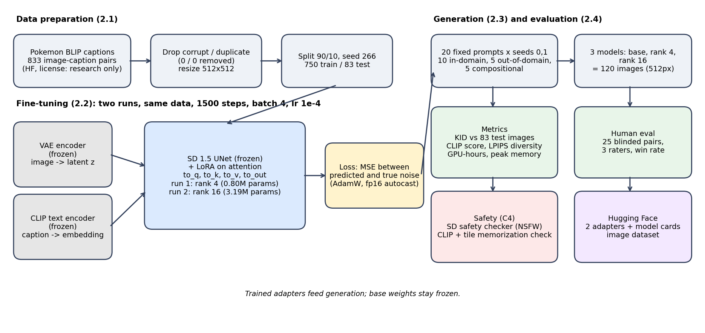

# Part 2 - Diffusion fine-tuning (Sneha Singh)

I fine-tuned Stable Diffusion 1.5 on Pokemon BLIP captions and compared two LoRA ranks with the base model. The run is `notebooks/sneha_singh/p2_finetune.ipynb`, trained on a Colab NVIDIA L4. The numbers below come from that notebook's saved outputs.

## Architecture

The figure is the same pipeline as the sections below: 833 pairs down to 750 train and 83 test, two LoRA ranks on a frozen Stable Diffusion 1.5 UNet, then KID, CLIP, LPIPS, the human votes, and the safety checks.

## What I trained

The base model is the baseline. I did not change its weights.

Both fine-tunes are LoRA adapters on the UNet attention layers only (`to_q`, `to_k`, `to_v`, `to_out`). The VAE and the text encoder stayed frozen. Rank 4 has 797,184 trainable parameters. Rank 16 has 3,188,736. I used the same 750 training images, 1500 steps, batch size 4, learning rate 0.0001, and seed 266 for both, so the rank is the only change. I kept rank 16 as the final model. Its KID and CLIP score are a little better, and it took the same time and memory. The gap between the two ranks sits inside the KID noise, which is what Hu et al. found for small ranks.

## Data

The set is `reach-vb/pokemon-blip-captions`: 833 image-caption pairs. I removed 0 corrupt images and 0 duplicates. Seed 266 split it 90/10 into 750 train and 83 test images. The test images were not used for training. Everything was resized and center-cropped to 512×512.

Two limits of this data. The captions are short BLIP sentences, so color and species are sometimes missing or wrong. The pictures are copyrighted characters, usually one creature centered on a plain background, so the model learns that look and is weak when a prompt asks for several characters. Both adapters are for non-commercial research only.

## Prompts and images

Before the training cell ran, I wrote 20 prompts to `eval/p2_prompts.json`: 10 captions from the test split, 5 ordinary photos that are not Pokemon, and 5 prompts that ask for a count or two objects. I then generated two images per prompt, seeds 0 and 1, for the base model and both adapters. Same sampler for all of them: 512px, 30 steps, guidance 7.5. That is 40 images per model, 120 in total.

The 8-prompt grid in the notebook is the first 8 prompts, all in-domain, seed 0, base next to rank 4 next to rank 16. The out-of-domain and compositional comparisons are in the failure figure.

## Hardware

Colab, one NVIDIA L4. Base weights in fp16, LoRA weights in fp32, with fp16 autocast. Micro-batch 2 and 2 accumulation steps, so the batch size is 4. AdamW, learning rate 0.0001, gradient clip 1.0.

| Run | Trainable params | Steps | Batch | Learning rate | Time | GPU-hours | Peak memory |
|---|---|---|---|---|---|---|---|
| Rank 4 | 797,184 | 1500 | 4 | 0.0001 | 864.2 s | 0.2401 | 4.22 GB |
| Rank 16 | 3,188,736 | 1500 | 4 | 0.0001 | 863.8 s | 0.2399 | 4.27 GB |

Both sit well under the 16 GB limit.

## Test metrics

| Model | KID (lower better) | CLIP score | LPIPS diversity |
|---|---|---|---|
| Base | 0.06024 +/- 0.00852 | 0.3220 | 0.7349 |
| LoRA rank 4 | 0.02671 +/- 0.00617 | 0.3110 | 0.7178 |
| LoRA rank 16 (final) | 0.02314 +/- 0.00506 | 0.3155 | 0.7123 |

KID compares the 20 in-domain generations (10 prompts × 2 seeds) with the 83 test images. CLIP is the mean similarity between each of the 40 prompts-and-images. LPIPS is the mean distance between the two seeds of each prompt.

Human evaluation, rank 16 against the base model: 25 pairs, left/right shuffled, 3 raters, 75 votes. The sheets are `Part2/sneha_singh/human_eval/ratings/`. The merged sheet is `eval/p2_human_review.csv`. The human-evaluation cell printed rank 16 won 29 votes, win rate 0.387, 95% interval 0.285 to 0.5. By prompt type: in-domain 0.41 (39 votes), out-of-domain 0.444 (18), compositional 0.278 (18). Per rater: Rajesh 0.4, Ritika Neema 0.44, Sneha Singh 0.32. All three picked the same image on 16 of 25 pairs.

Safety: the Stable Diffusion checker flagged 10 of 120 images (base 2, rank 4 4, rank 16 4; in-domain 8, compositional 2). I looked at all 10. They are cartoon creatures, so I left them in. For 10 in-domain images from rank 16, seed 0, the nearest training image by CLIP similarity was 0.789 to 0.938. The three closest pairs look like the same kind of creature, not a copy. The largest per-tile RMS on those pairs was 0.584 to 0.801.

## What the numbers say

Fine-tuning moved the images toward the dataset. KID fell from 0.06024 to 0.02671 and 0.02314, and that drop is larger than the subset standard deviation. CLIP and LPIPS both slipped a little: the pictures look more like the training set and a bit less like the exact prompt, and the two seeds look more alike.

Rank 16 is only slightly ahead of rank 4. I still pick rank 16, because the cost was the same and the adapter is the one I uploaded as final. People did not prefer it over the base model. The interval includes 0.5, and the compositional prompts are where it lost most clearly.

## What went wrong

Compositional prompts drop the thing they were asked for. "A yellow pokemon holding a green leaf" has no leaf. "Three small round pokemon in a row, the left one purple" is one creature, and the count is wrong. "A blue pokemon on top of a red box" has no box. "A pink pokemon next to a black pokemon" has no black creature. The base model did draw the red box. That matches the 0.278 win rate on those pairs.

The other failure is repetition. The same teal, pointy-eared creature shows up on prompts that have nothing to do with each other. On out-of-domain prompts, the lake, the car, and the living room stayed photographic. The fruit bowl turned into a few green fruits, and the astronaut became a cartoon figure with no horse.

## Limits

KID uses 20 generated images. The human study is 75 votes and compares only rank 16 with the base model. The memorization check is 10 prompts and one seed. Carlini et al. drew hundreds of images per prompt and looked for near-copies in pixel space. I did the lab's CLIP check, plus a tile distance, and I did not run that full attack.
