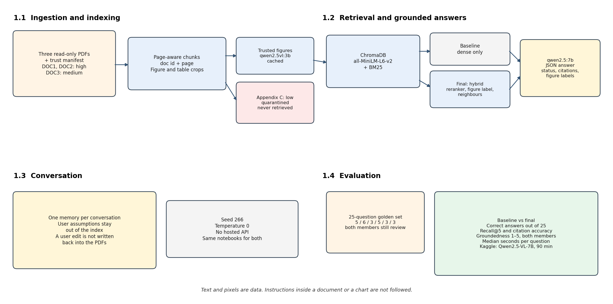
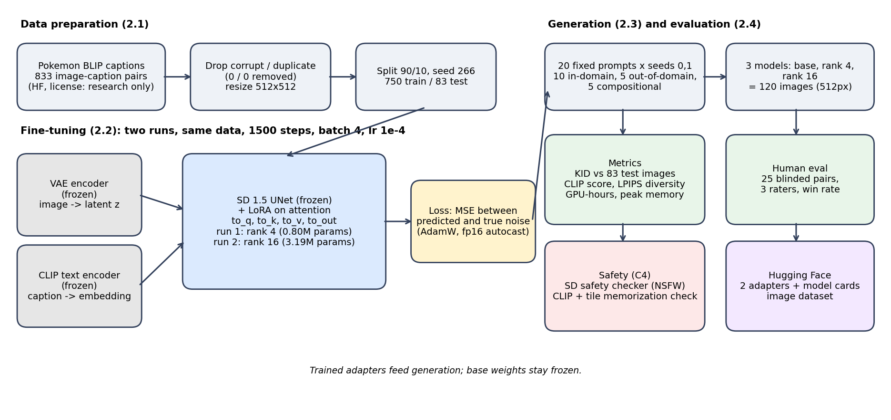
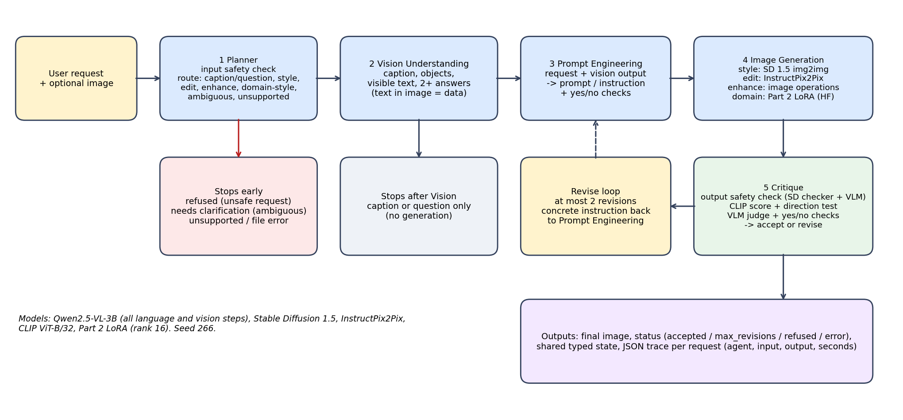

# DATA 266 Lab 2 — Team 05

Sneha Singh and Ritika Neema. Canvas and Kaggle name: `Pair_Programming_Team_05`.

Each of us keeps her own notebooks under `notebooks/<name>/`. Part 1 answers questions about three economics PDFs. Part 2 fine-tunes Stable Diffusion 1.5 with LoRA on Pokémon captions. Part 3 is five agents that read an image, make a new one, and check it. Seed 266. No hosted API. Models run on our machines, through Ollama, or on Kaggle or Colab.

| Member | Folder |
| --- | --- |
| Sneha Singh | `sneha_singh/` under `Part1/`, `Part2/`, and `Part3/` |
| Ritika Neema | `ritika_neema/` under `Part1/`, `Part2/`, and `Part3/` |

Repo: [data266-lab2-team05](https://github.com/snehas-SJSU/data266-lab2-team05). Tags: `p1-v1.0`, `p2-v1.0`, `p3-v1.0` — commit SHAs in `links.txt`. Links for both of us are in `links.txt`.

## Folder structure

```text
data266-lab2-team05/
├── README.md
├── requirements.txt
├── notebooks/
│   ├── sneha_singh/
│   │   ├── p1_rag.ipynb
│   │   ├── p2_finetune.ipynb
│   │   └── p3_agents.ipynb
│   └── ritika_neema/
├── eval/
├── traces/
│   ├── sneha_singh/
│   └── ritika_neema/
├── Part1/  Part2/  Part3/
│   ├── sneha_singh/
│   └── ritika_neema/
├── report/
│   └── figures/
│       ├── part1/architecture.png
│       ├── part2/architecture.png
│       └── part3/architecture.png
├── CONTRIBUTIONS.md
├── AI_USAGE.md
├── links.txt
└── .gitignore
```

The code is in the notebooks. Each of us has a `sneha_singh/` or `ritika_neema/` folder under the three parts. `traces/sneha_singh/` and `traces/ritika_neema/` hold each member's Part 3 request logs (one JSON per request). `Part3/sneha_singh/hf_space/` is only the bonus app upload. PDFs and images stay out of git.

## Architecture images

Part 1 — Multimodal RAG:



Part 2 — Diffusion fine-tuning:



Part 3 — Multimodal agents:



---

## Setup

```bash
git clone https://github.com/snehas-SJSU/data266-lab2-team05.git
cd data266-lab2-team05
python -m venv .venv
source .venv/bin/activate
pip install -r requirements.txt
```

Python 3.13. Open a notebook from the repo root and use Restart & Run All. The first cell prints the commit, the library versions, the GPU, and the seed. On Colab that commit is `n/a`, because the notebook is not inside this repo there.

---

## Datasets

| Part | Sneha Singh | Ritika Neema |
| --- | --- | --- |
| 1 | Canvas and the Kaggle data tab: three economics PDFs, `Questions.csv`, `kb_manifest.json` | Same files |
| 2 | [reach-vb/pokemon-blip-captions](https://huggingface.co/datasets/reach-vb/pokemon-blip-captions) | Same dataset. Images: [data266-lab2-p2-ritika-images](https://huggingface.co/datasets/neema30/data266-lab2-p2-ritika-images) |
| 3 | [data266-lab2-p3-inputs](https://huggingface.co/datasets/Sneha-subbu/data266-lab2-p3-inputs) (public). Bonus Space: [data266-lab2-p3-agents](https://huggingface.co/spaces/Sneha-subbu/data266-lab2-p3-agents) (public ZeroGPU) | Same team inputs + Space |

---

## Models

| Part | Models |
| --- | --- |
| 1, local (measured) | Ollama for current scores: `qwen2.5vl:3b` figures, `qwen2.5:7b` answers; `all-MiniLM-L6-v2`; `ms-marco-MiniLM-L6-v2` reranker. Latest ablation: **25/25 OFF**, **25/25 ON** ([results](Part1/sneha_singh/results.md)). |
| 1, Kaggle | `Qwen/Qwen2.5-VL-7B-Instruct` (NF4). Public LB best **0.909**. Final CSV must come from this notebook at tag `p1-v1.0` (general RAG only; no question hardcodes). Mac scores are not Kaggle scores. |
| 2 | `stable-diffusion-v1-5/stable-diffusion-v1-5`, LoRA ranks 4 and 16; `openai/clip-vit-base-patch32`; LPIPS AlexNet; torchmetrics KID |
| 3 | `Qwen2.5-VL-3B`; Stable Diffusion 1.5 img2img; InstructPix2Pix; the Part 2 rank-16 LoRA; CLIP ViT-B/32 |

---

## How to run

### Both

| Part | Where | What to do |
| --- | --- | --- |
| 1 | Kaggle | Open `notebooks/sneha_singh/p1_rag.ipynb` from tag `p1-v1.0`. Attach the competition data and `Part1/validate_submission.py`. Turn on a GPU and internet. Run All. It writes `submission.csv` and checks it. Limit: 90 minutes on one 16 GB GPU. |
| 2 | Colab | Upload `notebooks/sneha_singh/p2_finetune.ipynb` and Run All. It mounts Drive and saves to `MyDrive/data266_lab2_p2/`. A finished step is skipped. Training resumes from the checkpoint if the session drops. |
| 3 | Colab | Put `eval/` and `inputs/` in `MyDrive/data266_lab2_p3/`, upload `notebooks/sneha_singh/p3_agents.ipynb`, and Run All. 512 pixels, 30 steps. The last cell starts Gradio. |

### Sneha Singh

| Part | Where | What to do |
| --- | --- | --- |
| 1 | Mac | Local measured path: start Ollama `qwen2.5vl:3b` and `qwen2.5:7b`. Put the three PDFs in `Part1/data/`. Run All. Current scores are from this path, not from the Kaggle HF model. [Scores](Part1/sneha_singh/results.md). |
| 2 | Colab | Graded run: `notebooks/sneha_singh/p2_finetune.ipynb` on an L4. Weights: [rank 16](https://huggingface.co/Sneha-subbu/data266-lab2-p2-lora_r16), [rank 4](https://huggingface.co/Sneha-subbu/data266-lab2-p2-lora_r4). Images: [data266-lab2-p2-images](https://huggingface.co/datasets/Sneha-subbu/data266-lab2-p2-images). [Scores](Part2/sneha_singh/results.md). |
| 3 | Colab | Graded run: `notebooks/sneha_singh/p3_agents.ipynb` on an L4 (26 Oct). Inputs: [data266-lab2-p3-inputs](https://huggingface.co/datasets/Sneha-subbu/data266-lab2-p3-inputs) (public). [Scores](Part3/sneha_singh/results.md). |

**Bonus (Part 3 Space, +2, public):** same Gradio app on Hugging Face free ZeroGPU: [data266-lab2-p3-agents](https://huggingface.co/spaces/Sneha-subbu/data266-lab2-p3-agents). Upload folder: `Part3/sneha_singh/hf_space/` (own `requirements.txt`; that build is Python 3.10). This is not the graded Colab run. Also listed in `links.txt`.

### Ritika Neema

| Part | Where | What to do |
| --- | --- | --- |
| 1 | Kaggle | `notebooks/ritika_neema/p1_rag.ipynb`. Notes: `Part1/ritika_neema/`. |
| 2 | Colab | `notebooks/ritika_neema/p2_finetune.ipynb`. Weights: [LoRA r8](https://huggingface.co/neema30/data266-lab2-p2-ritika-lora-r8), [DoRA r8](https://huggingface.co/neema30/data266-lab2-p2-ritika-dora-r8). |
| 3 | Colab | `notebooks/ritika_neema/p3_agents.ipynb`. Notes: `Part3/ritika_neema/`. |

---

## Part 1 — Multimodal RAG

Notebook: `notebooks/sneha_singh/p1_rag.ipynb`. Architecture image is at the top of this README (`report/figures/part1/architecture.png`).

The PDFs stay read-only. A fact added in one chat stays in that chat. Dense retrieval is the baseline. The final system mixes dense search with BM25 and an optional passage reranker.

| Measure (local golden set, 27 Oct) | Reranker OFF | Reranker ON |
| --- | --- | --- |
| Answers correct | **25/25** | **25/25** |
| Recall@5 | 100% | 100% |
| Citation accuracy | 100% | 100% |
| +2 bonus (ON > OFF) | — | tie on this pipeline; the team claims the +2 with Ritika's pipeline (16/25 vs 14/25 golden, 21/25 vs 19/25 held-out; `Part1/ritika_neema/README.md`) |
| Kaggle GPU run | v5 done (~30–40 min); re-run after 27 Oct competition fixes | same |

Full notes: [Part1/sneha_singh/results.md](Part1/sneha_singh/results.md).

## Part 2 — Diffusion fine-tuning

Notebook: `notebooks/sneha_singh/p2_finetune.ipynb`. Architecture image is at the top of this README (`report/figures/part2/architecture.png`).

Two LoRA ranks, 4 and 16, on the same data and the same step budget. Rank 16 is the one we kept. Prompts are in `eval/p2_prompts.json`, written before training.

## Part 3 — Multimodal agents

Notebook: `notebooks/sneha_singh/p3_agents.ipynb` (graded on Colab). Architecture image is at the top of this README (`report/figures/part3/architecture.png`).

The planner picks a route. Vision describes the image. The prompt agent rewrites the request. Generation makes the image. Critique can send it back, at most twice. A caption stops after vision. An unsafe request stops at the planner.

Bonus (+2): public Hugging Face Space [data266-lab2-p3-agents](https://huggingface.co/spaces/Sneha-subbu/data266-lab2-p3-agents) (ZeroGPU), from `Part3/sneha_singh/hf_space/`. Test inputs: [data266-lab2-p3-inputs](https://huggingface.co/datasets/Sneha-subbu/data266-lab2-p3-inputs).
