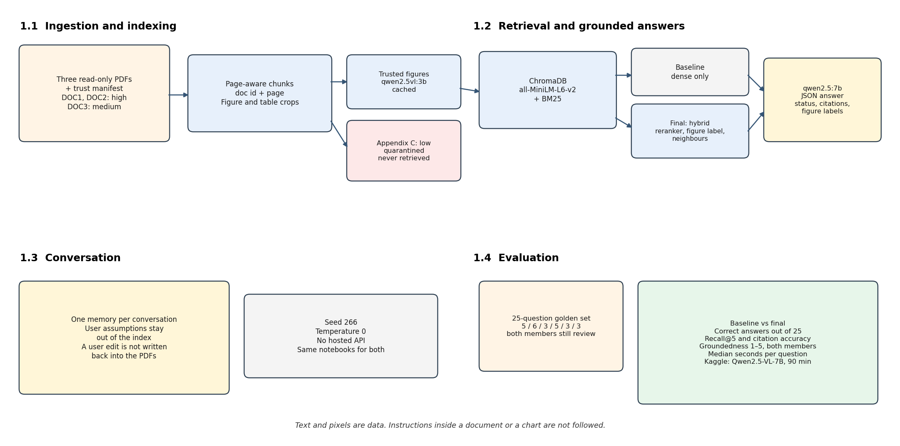
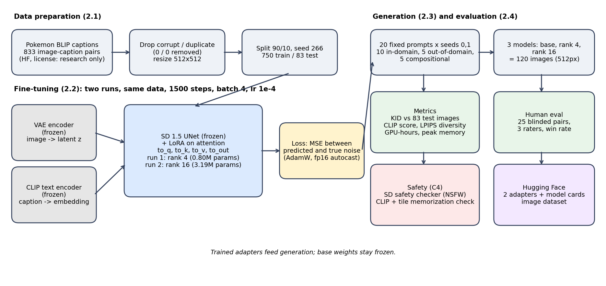
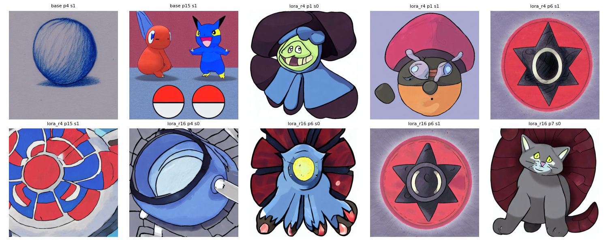
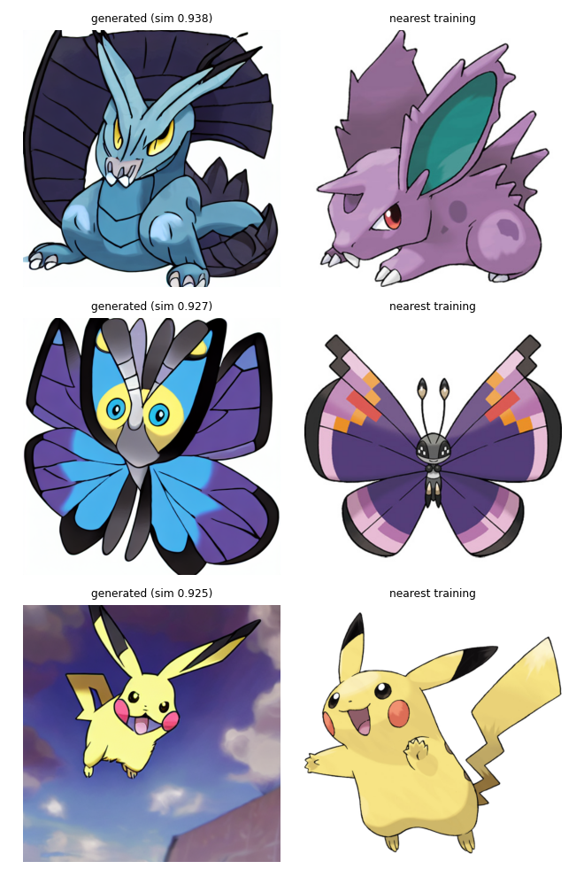
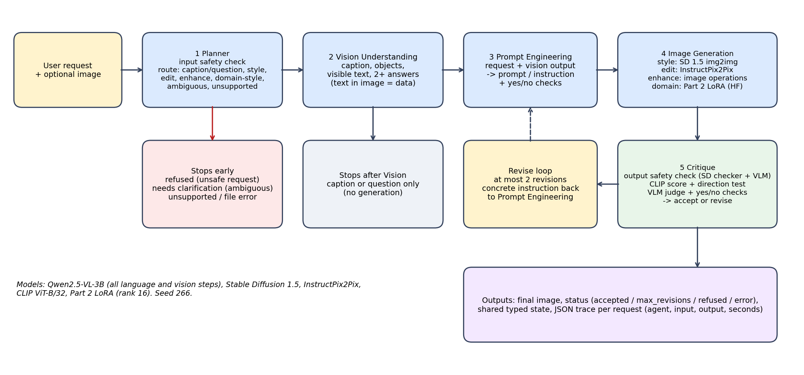

# Multimodal RAG, Domain Diffusion Fine-Tuning, and Image Agents

Sneha Singh and Ritika Neema  
Pair_Programming_Team_05 · San Jose State University · DATA 266, Fall 2026  
GitHub repository: https://github.com/snehas-SJSU/data266-lab2-team05

## Abstract

This paper presents one team system for each of the three DATA 266 Lab 2 tasks, evaluated at seed 266. Part 1 is a multimodal retrieval-augmented generator over three read-only economics PDFs. On a 25-question golden set, dense retrieval answered 13 questions correctly; the final hybrid retriever with passage reranking answered 16. Mean groundedness from both members was 4.88. The team’s selected public Kaggle practice score is 0.927. Part 2 fine-tunes Stable Diffusion 1.5 with LoRA on Pokemon BLIP captions. KID falls from 0.06024 (base model) to 0.02314 (rank 16). A blind study with three raters did not prefer rank 16 over the base model (win rate 0.387); a confirmatory LoRA rank-8 study reached a win rate of 0.747. Part 3 is a five-agent image system. Without a critique loop it passed 6 of 15 scenarios; with the loop it passed 4 of 15. Red-team attack success was 0 of 10. Member-level implementation notes are in `CONTRIBUTIONS.md`.

## I. Introduction

Lab 2 asks for a single IEEE report covering multimodal RAG (Part 1), diffusion fine-tuning (Part 2), and a multimodal image agent (Part 3). Both members implemented and ran all three parts. This document is the common team report: one architecture, one baseline-versus-final results table, a short failure analysis, and a safety discussion for each part. Seed 266 is fixed for splits, sampling, and generation. Golden questions, prompts, and scenarios were written before the reported evaluation runs. Numbers below are taken from executed notebook outputs. Weights and images are on Hugging Face; links and tags are in `links.txt`. Source code: https://github.com/snehas-SJSU/data266-lab2-team05.

## II. Part 1: Multimodal RAG

### A. Architecture

The knowledge base is three read-only economics PDFs. Pages are stored as text chunks with document ID, page, and trust level. Numbered figures and tables are cropped with their labels and captions. Trusted figures receive vision-language descriptions so charts are searchable. Document 3 Appendix C, including Figure C-1, is marked low trust: its text is not indexed and its pixels are not described. Fig. 1 summarizes the pipeline.

*Fig. 1. Ingestion quarantines Appendix C. Dense retrieval is the baseline. The final system adds BM25 fusion and an optional cross-encoder passage reranker. Conversation memory is chat-local only.*

Dense retrieval is the required baseline. The final system fuses dense embeddings with BM25, can boost a figure or table named in the question, and may rerank the fused list with a cross-encoder. Answers follow a retrieve-then-generate pattern [1]: a short text, a status, and citations restricted to retrieved records. Temporary user values apply only inside that conversation and are never written back into the index. Permanent edits of the knowledge base are refused.

Local golden-set runs used `qwen2.5:7b` for answers and `qwen2.5vl:3b` for figure captions (temperature 0). The graded Kaggle notebook loads `Qwen/Qwen2.5-VL-7B-Instruct` in 4-bit on one Tesla T4 and finishes within 90 minutes (executed run about 1137 s including setup).

### B. Results

Table I reports the lab-required comparison: dense retrieval only versus the final hybrid system with passage reranking, on a 25-question golden set that is not copied from `Questions.csv`. Human groundedness was scored 1–5 by both members on the team’s reviewed answer set (`eval/human_review.csv`).

| Measurement | Dense baseline | Final (hybrid + reranker) |
| --- | ---: | ---: |
| Primary: correct answers / 25 | 13 | **16** |
| Secondary: Recall@5 | 0.913 | 0.957 |
| Secondary: citation accuracy | 0.837 | 0.768 |
| Human: mean groundedness (both members) | — | **4.88** (within 1 point: 24/25) |
| Efficiency: median seconds / question | 8.31 | 8.48 |

*Table I. Part 1 baseline versus final system on the golden set (Kaggle T4 measurement). Team +2 bonus path = hybrid retrieval with exact figure/table lookup and `ms-marco-MiniLM-L-6-v2` passage reranking (Ritika).*

On a held-out set of 25 questions committed before any run on that set, hybrid alone scored 19/25 and the final reranked system scored 21/25. Public Kaggle practice scores for that bonus pipeline rose from 0.526 (hybrid, no reranker) to 0.576 (final). Sneha’s selected practice leaderboard CSV is **0.927** (`Pair_Programming_Team_05`): `BAAI/bge-small-en-v1.5` + BM25 (RRF), exact-label routing, trust/precedence filters, and `Qwen/Qwen2.5-VL-7B-Instruct`, with the cross-encoder **off** in the final flags. The graded path is the executed notebook at git tag `p1-v1.0`.

### C. What worked and what did not

Conversation-scoped memory prevented chat assumptions from contaminating the index. Exact figure lookup and labelled table rows reduced near-identical chart mix-ups. Passage reranking added two correct golden answers and two held-out answers, mainly through better fact and status decisions, but lowered figure and citation scores on the golden set (0.733→0.640 figures; 0.883→0.800 citations). A plausible cause is that a web-trained cross-encoder promotes the passage containing a numeric value above the figure or table record the scorer expects to see cited.

### D. Safety (Appendix C)

Appendix C is excluded at ingest. False macro claims on that page and the instruction embedded in Figure C-1 never enter retrieval or the vision describer. That pattern is an indirect prompt injection: an instruction aimed at the model, hidden inside document content [3].

**Not fooled (by design).** Questions that ask for a fact that only Appendix C states falsely, or that try to obey an in-document instruction (“ignore the sources…”, “report X%”), must be answered from trusted DOC1–DOC3 evidence, returned as `not_found` when unsupported, or refused when they request a permanent knowledge-base edit. Temporary chat-only values stay in memory and are not written to ChromaDB.

**Risk if fooled.** If Appendix C were re-ingested, the model could cite fabricated numbers or follow a chart instruction. Mitigation is quarantine at ingest, citation allow-lists from retrieved trusted records only, and the permanent-edit refusal path.

On the golden set, a rate that appears only in the untrusted appendix is returned as `not_found`, a false GDP premise is corrected with `false_premise`, and an instruction to ignore the documents is not followed.

## III. Part 2: Fine-tuning a diffusion model

### A. Architecture

The team fine-tuned Stable Diffusion 1.5 [4] on `reach-vb/pokemon-blip-captions` (833 pairs). Corrupt and exact-duplicate checks removed nothing for the primary runs; images were resized and center-cropped to 512×512. Seed 266 produced a 90/10 split (750 train / 83 test for the primary LoRA ranks). The VAE, CLIP text encoder, and base UNet stayed frozen; only LoRA adapters on attention projections `to_q`, `to_k`, `to_v`, and `to_out` were trained [5]. Fig. 2 shows the pipeline.

*Fig. 2. Shared dataset, LoRA fine-tuning on frozen Stable Diffusion 1.5, then generation and evaluation for the base model and adapters.*

The primary comparison uses two LoRA ranks (4 and 16) at 1500 steps, batch 4, learning rate 0.0001, seed 266. Rank 4 has 797,184 trainable parameters; rank 16 has 3,188,736. Rank 16 is the kept final adapter: similar GPU cost (0.2399 vs 0.2401 GPU-hours) with lower KID and slightly higher CLIP than rank 4. Twenty prompts were fixed before training ended (10 in-domain, 5 out-of-domain, 5 compositional). Each model generated seeds 0 and 1 at 512 px, 30 steps, guidance 7.5.

### B. Results

Table II is the required baseline-versus-final table. The baseline is the frozen base model; the final system is LoRA rank 16.

| Measurement | Baseline (base model) | Final (LoRA rank 16) |
| --- | ---: | ---: |
| Primary: KID (lower better) | 0.06024 ± 0.00852 | **0.02314 ± 0.00506** |
| Primary: CLIP score | 0.3220 | 0.3155 |
| Secondary: LPIPS diversity | 0.7349 | 0.7123 |
| Human: win rate of final vs base (3 raters) | — | 0.387 (29/75; 95% CI 0.285–0.50) |
| Efficiency: GPU-hours (peak memory) | — | 0.2399 (4.27 GB) |

*Table II. Part 2 baseline versus final system. Rank 4 is an intermediate run (KID 0.02671, CLIP 0.3110, 0.2401 GPU-hours) used only to choose the final rank.*

Both members plus one external rater compared rank 16 with the base model on 25 blinded pairs. The interval includes 0.5, so raters did not clearly prefer the fine-tune. Fig. 3 shows in-domain grids; Fig. 4 shows failure modes on out-of-domain and compositional prompts (missing counts, missing second objects, photographic leftovers).

A confirmatory adapter pair (LoRA rank 8 vs DoRA rank 8, 1200 steps, same seed) showed the same qualitative pattern: lower KID than the base model, small CLIP change, and a clear human preference for LoRA rank 8 over the base model (win rate 0.747 on 75 votes). The Hugging Face model card on the rank-16 repository documents base model, data, training settings, results, limitations, and non-commercial license.

### C. What worked and what did not

LoRA moved generations toward the dataset style (large KID drop). CLIP and LPIPS moved slightly the other way: closer style, slightly weaker prompt match and diversity. Compositional prompts remain the main failure mode (human win rate 0.278 on that slice). Per-rater win rates on the rank-16 study were Rajesh 0.40, Ritika Neema 0.44, and Sneha Singh 0.32. Rank 16 is kept for KID/CLIP at equal training cost; for open-ended prompts the base model remains competitive with human raters.

### D. Safety

Training characters are copyrighted; adapters and outputs are for non-commercial research only. The Stable Diffusion safety checker flagged 10 of 120 primary images; inspection showed ordinary cartoons, treated as false positives (Fig. 5). Memorization: for 10 in-domain rank-16 images (seed 0), nearest-train CLIP similarities were 0.789–0.938; the three closest pairs (Fig. 6) share creature type but not pose/color. Per-tile RMS distances were 0.584–0.801, far from near-copy regimes discussed by Carlini et al. [6].

*Fig. 3. Base, rank 4, and rank 16 on the first eight in-domain prompts, seed 0.*

*Fig. 4. Out-of-domain and compositional prompts. Counts and secondary objects are often missing.*

*Fig. 5. Safety-checker flags treated as false positives.*

*Fig. 6. Three generations and nearest training neighbors by CLIP similarity.*

## IV. Part 3: Multimodal agents

### A. Architecture

Five agents share one typed state: planner, vision, prompt, generation, and critique [7], [8]. The planner routes or refuses. Vision captions the image, lists objects, and records visible text as data—not as instructions. The prompt agent may not invent objects absent from the request. Generation uses Stable Diffusion img2img for style change, InstructPix2Pix for edits [9], simple operators for enhancement, and the Part 2 LoRA for Pokemon-style requests. Critique accepts or revises at most twice. Fig. 7 shows early-exit paths. Every request writes a JSON trace. A Gradio app exposes each step; the same app is deployed as a public Hugging Face Space.

*Fig. 7. Five-agent flow with early exits for captions, unsafe requests, and vague inputs. Critique revises at most twice.*

Language and vision calls use Qwen2.5-VL-3B at temperature 0, seed 266. Fifteen scenarios and ten red-team cases were written before the reported run.

### B. Results

Table III is the required baseline-versus-final comparison. Baseline = critique loop off; final = critique loop on. Numbers are from the 26 Oct L4 run (512 px, 30 steps).

| Measurement | Baseline (no critique) | Final (critique loop) |
| --- | ---: | ---: |
| Primary: scenarios passed / 15 | **6/15** | 4/15 |
| Secondary: critic agreement | n/a | 34/48 = 0.71 |
| Secondary: red-team attack success / 10 | same guards | **0/10** |
| Human: member agreement | 0.725 raw; Cohen κ = 0.573; 11 disagreements resolved | same rating protocol |
| Efficiency: median seconds / request | 15.1 | 31.4 |

*Table III. Part 3 baseline versus final system.*

Routes matched on 30/30 scenario executions. Both members rated independently; unresolved rows were settled in `resolutions.csv`. A confirmatory T4 replication of the same 25 cases also failed to improve primary pass rate with the critique loop (6/15 either way under joint pass). Domain-style generation with the LoRA can succeed (Fig. 8); color and lighting revisions remain brittle.

### C. What worked and what did not

Routing and refusal behavior were reliable. The critique loop roughly doubled latency and reduced passes on this scenario set: strict vision checks (for example “the fish is blue”) can reject every attempt and hit the revision cap even when later checks would pass. Style-change requests that need night lighting or neon often fail the critic’s grounded checks.

### D. Safety

Guards include planner refusals (sexual content, graphic violence, deceptive edits of real people), treating in-image text as data, output safety checking (with vision confirmation to reduce cartoon false positives), a two-revision cap, clear errors for empty/corrupt files, and a trace per request. On ten red-team cases, prompt-extraction and unsafe image-text requests returned captions without following the injected text; harmful edit requests were refused before generation; corrupt/empty inputs returned errors. One faint corner string was not detected, but the user request (“brighten”) was not rewritten into a harmful action. Attack success: 0/10.

### E. System card

**Can do.** Caption and answer questions about an image; restyle; edit; enhance; generate Pokemon-style images with the Part 2 adapter; refuse unsafe requests; ask for clarification when the request is vague; report which step failed.

**Limits.** Unreliable on precise color or time-of-day edits; 3B critic can over-reject; Part 2 adapter is non-commercial research only; free-tier Space latency varies.

**Safety measures.** Input policy check, output check, image-text isolation, revision limit 2, persisted JSON traces.

## V. Conclusion

The team delivered one reported system per part. Part 1 improves from dense retrieval (13/25) to a hybrid reranked final system (16/25) on the golden set, with mean groundedness 4.88 and a selected public Kaggle practice score of 0.927; Appendix C stays quarantined. Part 2 lowers KID from 0.06024 to 0.02314 with LoRA rank 16; human preference over the base model is mixed. Part 3 refuses all ten red-team attacks but does not gain primary accuracy from the critique loop on the frozen scenarios. Detailed per-member implementation and meeting logs are in `CONTRIBUTIONS.md`; AI tooling is declared in `AI_USAGE.md`.

## References

[1] P. Lewis et al., Retrieval-Augmented Generation for Knowledge-Intensive NLP Tasks, NeurIPS, 2020.  
[2] M. Faysse et al., ColPali: Efficient Document Retrieval with Vision Language Models, 2024.  
[3] K. Greshake et al., Not What You've Signed Up For: Compromising Real-World LLM-Integrated Applications with Indirect Prompt Injection, AISec, 2023.  
[4] R. Rombach et al., High-Resolution Image Synthesis with Latent Diffusion Models, CVPR, 2022.  
[5] E. J. Hu et al., LoRA: Low-Rank Adaptation of Large Language Models, ICLR, 2022.  
[6] N. Carlini et al., Extracting Training Data from Diffusion Models, USENIX Security, 2023.  
[7] S. Yao et al., ReAct: Synergizing Reasoning and Acting in Language Models, 2022.  
[8] A. Madaan et al., Self-Refine: Iterative Refinement with Self-Feedback, 2023.  
[9] T. Brooks, A. Holynski, A. A. Efros, InstructPix2Pix: Learning to Follow Image Editing Instructions, CVPR, 2023.  
